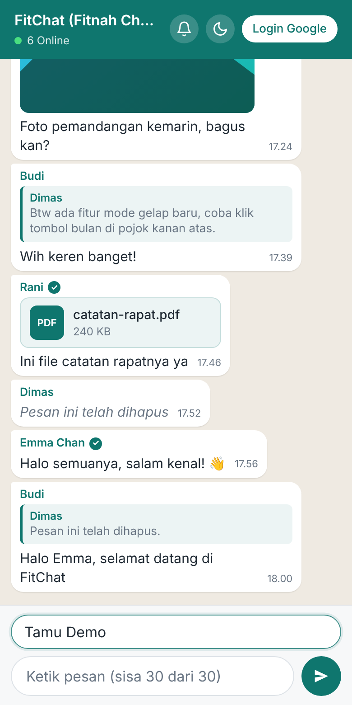
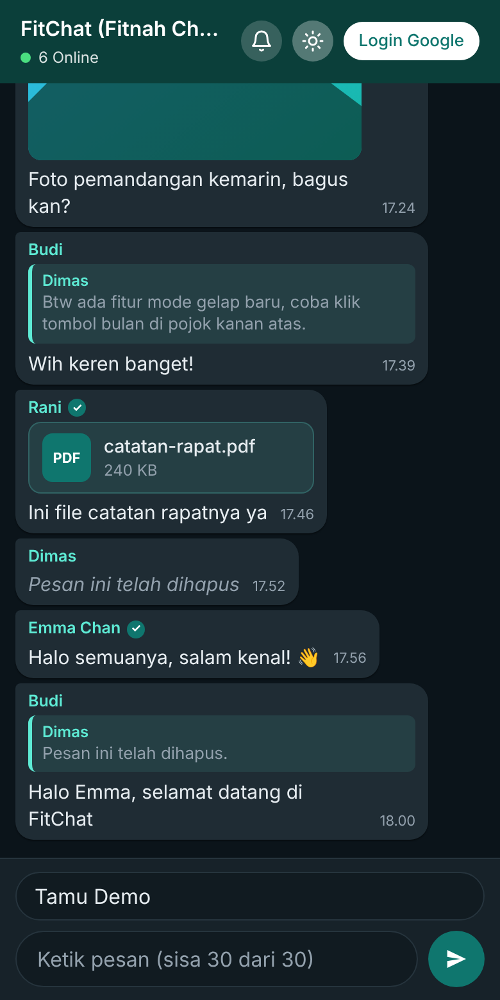
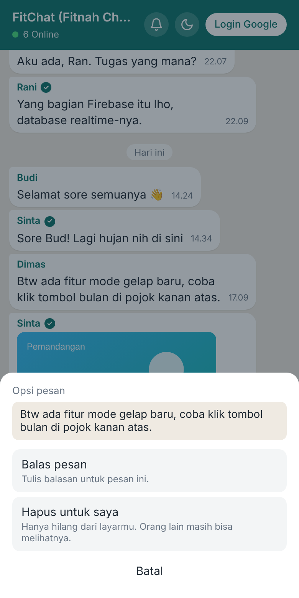
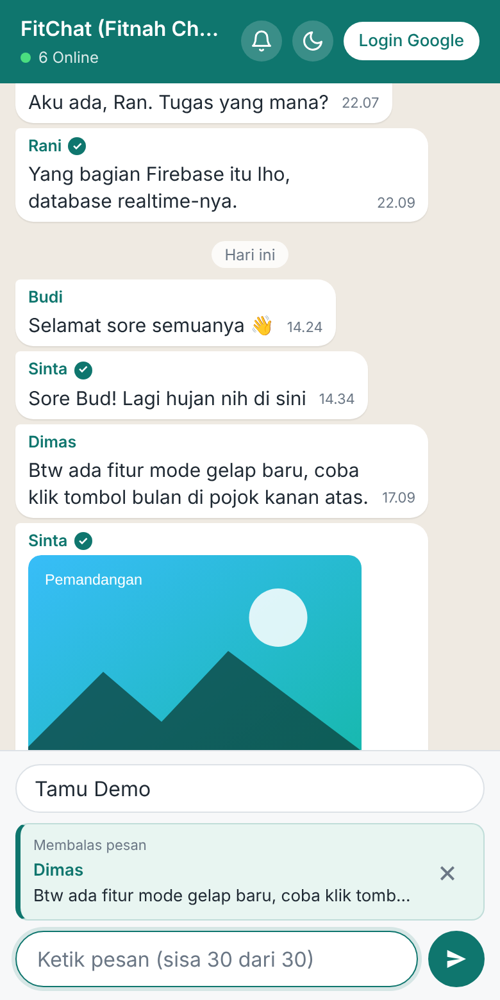
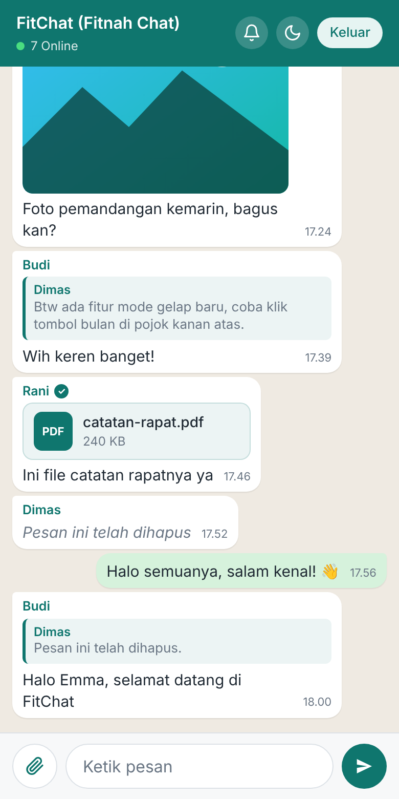
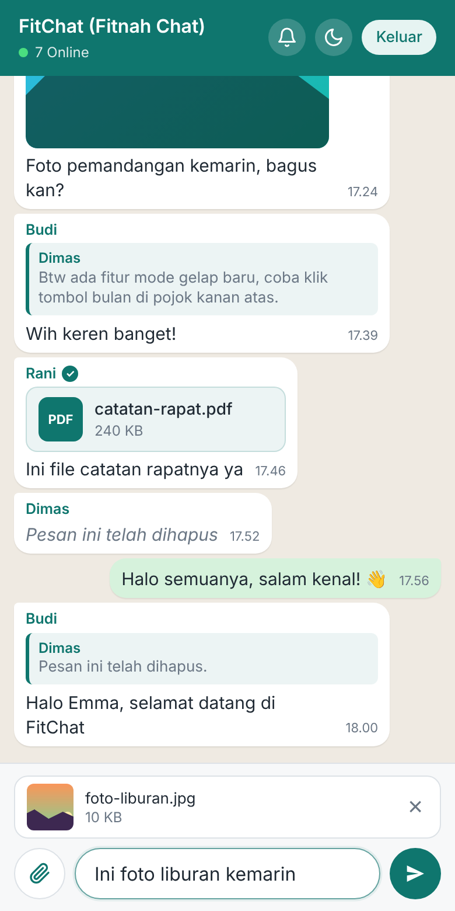
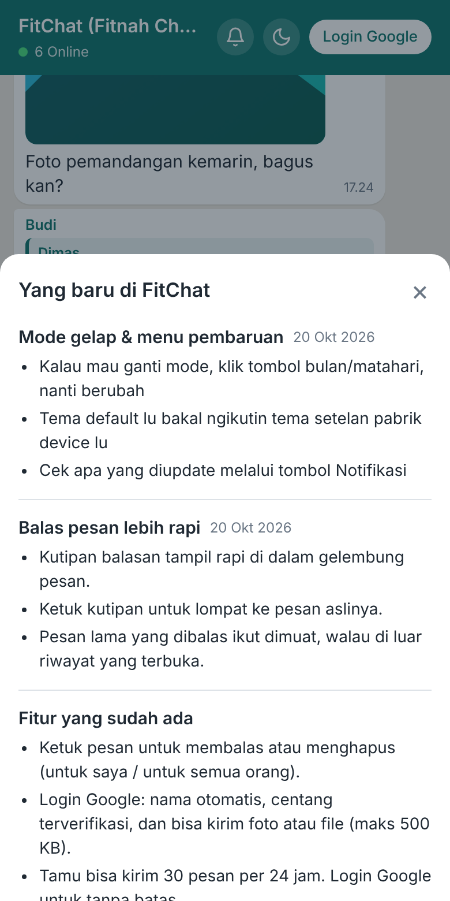
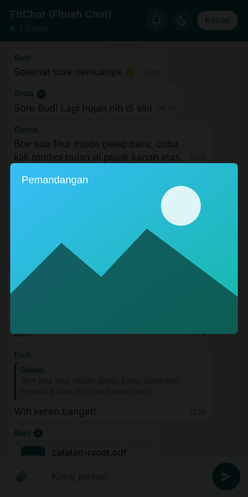
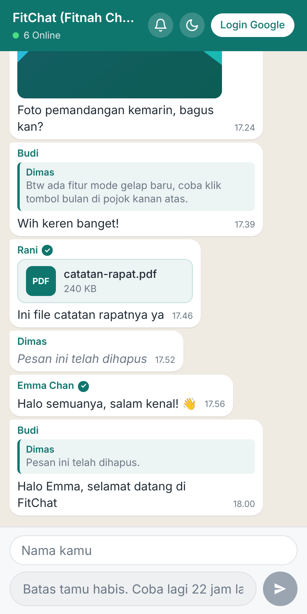
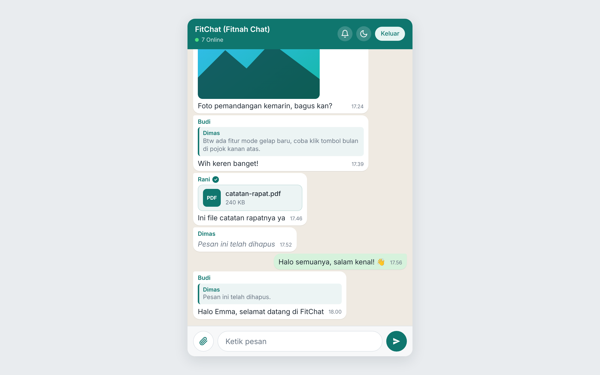

# FitChat (Fitnah Chat)

Link website: https://maestroo12.github.io/chat-global/

Aplikasi **chat global realtime** berbasis web. Siapa pun bisa langsung ngobrol sebagai **tamu** tanpa daftar, atau **login dengan Google** untuk mendapat centang terverifikasi, kirim foto/file, dan kirim pesan tanpa batas.

Dibangun dengan HTML, CSS, dan JavaScript murni (tanpa framework dan tanpa proses build), dengan **Firebase** (Authentication, Realtime Database, Hosting) sebagai backend.



## Fitur

- **Empat panel**: Beranda, Postingan, Chat, dan Profil. Di laptop/PC menunya di samping dan area kerjanya lebar, di HP menunya di bawah. Alamat tiap panel: `#/beranda`, `#/postingan`, `#/chat`, `#/profil`.
- **Postingan** (feed realtime): akun Google bisa menulis postingan (maks. 500 karakter) yang langsung muncul di layar semua orang tanpa refresh. Setiap postingan bisa diberi **suka** (semua pengguna, termasuk tamu) dan **komentar** (akun Google, maks. 300 karakter). Jumlah suka dan komentar berubah realtime. Pemilik postingan bisa menghapus postingannya (suka dan komentarnya ikut terhapus) dan komentar orang lain di postingannya; penulis komentar bisa menghapus komentarnya; admin bisa menghapus apa saja. Postingan baru dari orang lain memunculkan angka di menu saat panelnya tidak dibuka. Admin yang membatasi pesan sebuah akun ke 0 juga mencegahnya memposting dan berkomentar; akun yang diblokir tidak bisa memposting, berkomentar, atau memberi suka.
- **Beranda** (sengaja dibuat ringkas): sapaan, 4 obrolan terbaru, 5 orang online teratas, pembaruan terbaru, dan ajakan login untuk tamu. Pesan yang belum dibaca muncul sebagai angka di menu Chat dan titik di daftar obrolan. Tombol lonceng di bilah atas membuka daftar pembaruan lengkap, dengan titik merah saat ada info baru.
- **Profil**: avatar, nama, label akun, email, bio, info akun (ID dan tanggal bergabung), ubah nama tampilan dan bio (akun Google), jatah tamu, saklar mode gelap, login/keluar. Setiap info hanya tampil satu kali.
- **Foto profil**: akun Google (User dan Admin) bisa ganti/hapus foto lewat menu Profil; tamu tidak bisa. Foto dipotong persegi dan dikecilkan otomatis di browser (192 px, JPEG), lalu disimpan di `avatars/{uid}`. Foto tampil di samping pesan, Beranda, dan daftar online. Siapa pun (termasuk tamu) bisa mengetuk foto orang untuk membuka profilnya, **hanya lihat**: label Admin atau Tamu (akun Google biasa tanpa label), status online, dan bio kalau ada. Admin mengganti/menghapus foto orang lain lewat Panel admin → "Cek & atur pengguna", bukan dari kartu profil.
- **Chat realtime** untuk semua pengguna dalam satu ruang global.
- **Masuk sebagai tamu** (Firebase Anonymous Auth), cukup isi nama. Batas ganti nama 5x per hari, baru dihitung saat pesan dengan nama baru benar-benar terkirim.
- **Login Google**: nama otomatis, centang terverifikasi, kirim foto/file, tanpa batas pesan.
- **Penanda akun di pesan**: akun Google ditandai centang (✓), tamu tanpa centang, dan Admin mendapat label "Admin" di samping nama. Label "User" dan "Anon" tidak ditampilkan di tiap pesan supaya tidak memakan tempat. Daftar admin dibaca realtime oleh semua akun, jadi label Admin konsisten untuk siapa pun yang melihat.
- **Centang pesan**: pesan sendiri menampilkan ✓ (belum ada pengguna lain online), ✓✓ abu-abu (ada pengguna lain online), dan ✓✓ biru (sudah dibaca pengguna lain). Status baca dicatat per akun di `reads/{uid}` (pesan terakhir yang dilihat).
- **Nama tampilan**: tamu, akun Google biasa, dan admin bisa punya nama sendiri (tidak harus ikut Google). Nama yang disimpan berlaku untuk seluruh riwayat pesan akun itu. Tamu: lewat kolom nama di halaman Chat (ada batas ganti nama). Akun Google: kolom nama di Profil (kosongkan untuk kembali ke nama Google). Admin: lewat Panel admin. Disimpan di `adminNames/{uid}` (admin) dan `userNames/{uid}` (lainnya).
- **Batas ganti nama tamu per IP**: batas 5x/hari dihitung berdasarkan hash IP publik (diambil dari ipify), jadi ganti browser/perangkat di jaringan yang sama tidak mereset hitungan, dan nama terakhir ikut tersimpan di database. Kalau IP tidak bisa didapat (mis. diblokir ad-blocker), batas jatuh ke ID perangkat. Catatan: jaringan yang dipakai bersama (kampus, kantor, operator seluler) berbagi satu jatah, dan karena IP dilaporkan browser ini bukan keamanan penuh.
- **Balas pesan** dengan kutipan di dalam gelembung. Ketuk kutipan untuk lompat ke pesan aslinya.
- **Hapus pesan**: "Hapus untuk saya" (hanya hilang di layarmu) atau "Hapus untuk semua orang" (isi pesan dihapus, tersisa keterangan "Pesan ini telah dihapus").
- **Kirim foto dan file** (khusus akun Google). Foto dikecilkan otomatis di browser sebelum dikirim, dan bisa dibuka dalam tampilan penuh (lightbox).
- **Riwayat pesan**: tombol "Muat pesan lama" membuka hingga 1000 pesan terakhir, 100 pesan per muatan (tidak otomatis saat scroll). Admin bisa menghapus N pesan terlama lewat Panel admin.
- **Admin: cek profil & atur pengguna** (Panel admin → "Cek & atur pengguna", atau menu pesan → "Cek profil pengirim"). Cari lewat ID lengkap, 3+ huruf awal ID, atau nama. Kartu profil menampilkan nama, jenis akun (Admin/Akun Google/Tamu), status online, bio, 5 pesan terakhir, dan status blokir. Dari kartu yang sama admin bisa mengatur per pengguna: batas pesan per 24 jam, batas ganti nama per 24 jam (tamu), panjang maksimal pesan, dan larangan kirim foto/file. Kolom dikosongkan = pakai bawaan. Pengaturan langsung berlaku dan ditegakkan juga oleh Database Rules.
- **Indikator online**: jumlah orang yang sedang online tampil di bawah judul chat.
- **Mode terang/gelap**: mengikuti setelan perangkat dan bisa diganti manual lewat saklar di Profil → Pengaturan.
- **Menu "Yang baru"**: daftar pembaruan (tombol lonceng di Beranda) dengan titik merah saat ada info baru.
- **Batas pesan tamu** per 24 jam, dijaga di sisi klien dan di Database Rules.

### Prinsip tampilan ringkas

- Satu info, satu tempat: label akun hanya di kartu identitas Profil, jumlah online di header Chat dan kartu "Sedang online", jatah tamu di Profil, tombol login di Beranda (tamu) dan Profil → Pengaturan → Akun.
- Panel yang tidak dibuka tidak digambar ulang. Beranda juga melewati render ulang kalau isinya tidak berubah, jadi avatar dan foto tidak dimuat berulang.

## Cuplikan layar

|                                                       |                                                   |                                                     |
| ----------------------------------------------------- | ------------------------------------------------- | --------------------------------------------------- |
|      |  |  |
| Mode gelap                                            | Menu pesan                                        | Balas pesan                                         |
|  |  |      |
| Login Google                                          | Kirim foto                                        | Menu "Yang baru"                                    |
|      |  |          |
| Foto tampilan penuh                                   | Batas pesan tamu                                  | Tampilan desktop                                    |

## Tamu vs Login Google

|                       | Tamu                              | Login Google              |
| --------------------- | --------------------------------- | ------------------------- |
| Kirim pesan teks      | Ya, dibatasi per 24 jam           | Ya, tanpa batas           |
| Kirim foto/file       | Tidak                             | Ya                        |
| Lihat postingan dan beri suka | Ya                        | Ya                        |
| Buat postingan dan komentar   | Tidak                     | Ya                        |
| Centang terverifikasi | Tidak                             | Ya                        |
| Nama                  | Diisi sendiri (maks. 24 karakter, ganti max 5x/hari) | Otomatis dari akun Google, bisa diganti |
| Foto profil dan bio   | Tidak                             | Ya                        |

## Batas aplikasi

Semua batas ada di `assets/js/config.js` (objek `LIMITS`).

| Batas                             | Nilai             |
| --------------------------------- | ----------------- |
| Panjang pesan teks                | 500 karakter      |
| Pesan tamu per 24 jam             | 30 pesan          |
| Ganti nama tamu per 24 jam        | 5 kali            |
| Ukuran foto (dikecilkan otomatis) | di bawah 350 KB   |
| Ukuran file biasa                 | 500 KB            |
| Riwayat pesan yang bisa dibuka    | 1000 pesan terbaru |
| Pesan per muatan                  | 100 pesan         |
| Panjang postingan                 | 500 karakter      |
| Panjang komentar                  | 300 karakter      |
| Postingan per muatan              | 20 postingan      |
| Jeda antar postingan / komentar   | 5 detik / 2 detik (sisi klien) |

> **Catatan:** `database.rules.json` memakai plafon yang lebih longgar sebagai pengaman terakhir (maks. 30 pesan tamu per 24 jam, 5 ganti nama tamu per 24 jam, file 512000 byte). Jika mengubah angka di `config.js`, sesuaikan juga aturan terkait di `database.rules.json`.

## Teknologi

- **Frontend**: HTML, CSS, dan JavaScript (ES Modules), tanpa build tool.
- **Firebase JS SDK 13.0.0** dimuat dari `gstatic.com`.
- **Firebase Authentication**: Anonymous dan Google Sign-In.
- **Firebase Realtime Database**: pesan, status online, dan batas tamu.
- **Firebase Hosting**: dengan header keamanan (CSP, HSTS, dan lainnya).

## Struktur proyek

```
.
├── index.html               # Halaman utama (menu + panel Beranda, Chat, Profil, dan dialog)
├── 404.html                 # Halaman tidak ditemukan
├── favicon.svg
├── firebase.json            # Konfigurasi Hosting + Database + header keamanan
├── database.rules.json      # Aturan keamanan Realtime Database
├── assets/
│   ├── css/
│   │   ├── style.css        # Gaya utama chat, dialog, dan tema terang/gelap
│   │   ├── panels.css       # Kerangka menu + panel, Beranda, Profil
│   │   ├── postingan.css    # Panel Postingan: kartu, suka, komentar
│   │   └── 404.css
│   └── js/
│       ├── main.js          # Logika utama: auth, chat, reply, hapus, upload, presence
│       ├── config.js        # Konfigurasi Firebase dan LIMITS
│       ├── nav.js           # Perpindahan panel, badge menu, kartu akun di menu samping
│       ├── beranda.js       # Panel Beranda
│       ├── postingan.js     # Panel Postingan: feed realtime, posting, suka, komentar
│       ├── profil.js        # Panel Profil: nama, bio, foto, info akun, pengaturan
│       ├── profil-lihat.js  # Kartu profil orang lain (hanya lihat), terbuka saat foto diketuk
│       ├── foto.js          # Foto profil: kecilkan gambar, simpan ke avatars/{uid}, cache
│       ├── ui.js            # Pembantu tampilan (el, avatar, format waktu)
│       ├── admin.js         # Panel admin: blokir, hapus riwayat, nama admin
│       ├── admin-pengguna.js # Admin: cek profil & atur pengguna
│       ├── google-login.js  # Login Google lewat Google Identity Services (untuk host non-Firebase)
│       ├── news.js          # Daftar pembaruan untuk menu "Yang baru"
│       ├── utils.js         # Fungsi bantu (format ukuran, wrapper localStorage)
│       └── theme-init.js    # Menerapkan tema sebelum halaman tampil (anti-berkedip)
├── scripts/
│   └── check.mjs            # Pemeriksaan ringan sebelum deploy
└── docs/
    └── screenshots/         # Gambar untuk README
```

## Struktur data (Realtime Database)

| Path                       | Isi                                                                                     | Akses                                          |
| -------------------------- | --------------------------------------------------------------------------------------- | ---------------------------------------------- |
| `chat/{messageId}`         | Pesan: `uid`, `name`, `timestamp`, `text` atau `file`, `verified`, `replyTo`, `deleted` | Baca: pengguna login. Tulis: pemilik pesan     |
| `posts/{postId}`           | Postingan: `uid`, `name`, `text`, `timestamp`                                           | Baca: pengguna login. Tulis: akun Google (buat), pemilik atau admin (hapus) |
| `postLikes/{postId}/{uid}` | Suka: `true`. Satu akun satu suka                                                       | Baca: pengguna login. Tulis: pemilik suka itu; pemilik postingan/admin boleh menghapus semuanya |
| `postComments/{postId}/{commentId}` | Komentar: `uid`, `name`, `text`, `timestamp`                                   | Baca: pengguna login. Tulis: akun Google (buat), penulis, pemilik postingan, atau admin (hapus) |
| `files/{fileId}`           | Data file sebagai data URL base64 (maks. 512000 byte)                                   | Baca: pengguna login. Tulis: hanya akun Google |
| `users/{uid}`              | Status online: `name`, `online`, `lastSeen`                                             | Baca: pengguna login. Tulis: pemilik           |
| `hidden/{uid}/{messageId}` | Pesan yang disembunyikan ("Hapus untuk saya")                                           | Hanya pemilik                                  |
| `userSettings/{uid}`       | Pengaturan khusus pengguna: `msgLimit`, `nameLimit`, `maxText`, `noFile`, `at`, `by`    | Baca: pemilik dan admin. Tulis: hanya admin    |
| `userLimit/{uid}`          | Penghitung pesan akun Google yang diberi `msgLimit` (`count`, `start`)                  | Baca: pemilik dan admin. Tulis: pemilik        |
| `avatars/{uid}`            | Foto profil (data URL JPEG kecil), `by`, `at`, `src`                                    | Baca: pengguna login. Tulis: pemilik akun Google atau admin |
| `profiles/{uid}`           | Bio akun Google (`bio`, `at`)                                                           | Baca: pengguna login. Tulis: pemilik           |
| `reads/{uid}`              | Pesan terakhir yang sudah dibaca (untuk centang biru dan angka belum dibaca)            | Pemilik                                        |
| `adminNames/{uid}` / `userNames/{uid}` | Nama tampilan admin / pengguna lain                                         | Pemilik (admin lewat Panel admin)              |
| `anonDevice/{uid}`         | Pemetaan akun tamu ke ID perangkat                                                      | Hanya pemilik                                  |
| `deviceLimit/{deviceId}`   | Penghitung pesan tamu (`count`, `start`)                                                | Hanya perangkat terkait                        |
| `deviceNameLimit/{deviceId}` | Penghitung ganti nama tamu (`count`, `start`)                                           | Hanya perangkat terkait                        |

Aturan di `database.rules.json` memvalidasi tipe dan panjang setiap field, memastikan `uid` sesuai pengirim, hanya mengizinkan pesan dihapus oleh pengirimnya sendiri, dan mencegah tamu mengirim file atau mengklaim status terverifikasi.

### Pengaturan per pengguna (admin)

| Field       | Arti                                         | Bawaan                                  | Berlaku untuk |
| ----------- | -------------------------------------------- | --------------------------------------- | ------------- |
| `msgLimit`  | Batas pesan per 24 jam (0 = tidak boleh kirim) | Tamu 30, akun Google tanpa batas        | Tamu dan Google |
| `nameLimit` | Batas ganti nama per 24 jam                  | 5                                       | Tamu          |
| `maxText`   | Panjang maksimal satu pesan (1-500)          | 500                                     | Semua         |
| `noFile`    | `true` = dilarang kirim foto/file            | Boleh (akun Google)                     | Akun Google   |

Catatan: pengaturan melekat pada **ID akun** (uid). Tamu yang menghapus data browser mendapat uid baru, sehingga bawaan berlaku lagi (batas pesan tamu tetap dijaga per perangkat, dan batas ganti nama per IP, seperti sebelumnya). Admin harus mendeploy `database.rules.json` terbaru (`firebase deploy --only database`) agar fitur ini berfungsi dan batasnya ditegakkan di server.

## Menjalankan secara lokal

Karena memakai ES Modules, halaman harus dibuka lewat server lokal (bukan klik dua kali pada `index.html`).

```bash
# Opsi 1: Firebase Emulator / Hosting lokal
npm install -g firebase-tools
firebase serve --only hosting

# Opsi 2: server statis apa saja
npx serve .
# atau
python -m http.server 8080
```

Lalu buka `http://localhost:5000` (Firebase) atau `http://localhost:8080` (Python).

> Agar login Google berjalan di `localhost`, pastikan `localhost` ada di **Authentication → Settings → Authorized domains** pada Firebase Console.

## Setup Firebase (jika memakai proyek sendiri)

1. Buat proyek di [Firebase Console](https://console.firebase.google.com/).
2. Aktifkan **Authentication** dan nyalakan provider **Anonymous** dan **Google**.
3. Buat **Realtime Database** (disarankan region terdekat, mis. `asia-southeast1`).
4. Daftarkan aplikasi web, lalu salin konfigurasinya ke `firebaseConfig` di `assets/js/config.js`.
5. Pasang CLI dan hubungkan proyek:
   ```bash
   npm install -g firebase-tools
   firebase login
   firebase use --add
   ```
6. Perbarui domain Firebase di header `Content-Security-Policy` pada `firebase.json` (bagian `frame-src` masih menunjuk ke `chat-globall.firebaseapp.com`) agar sesuai dengan proyekmu.

## Deploy

```bash
# Pemeriksaan sebelum deploy (opsional)
node scripts/check.mjs

# Deploy aturan database + hosting
firebase deploy

# Atau terpisah
firebase deploy --only database
firebase deploy --only hosting
```

`scripts/check.mjs` memeriksa bahwa file JSON valid, semua file di `assets/js` bebas error sintaks, dan semua file yang dirujuk `index.html` ada. Skrip ini juga membaca `.firebaserc` dan `package.json`, jadi pastikan keduanya ada di root proyek.

## Menambah pengumuman "Yang baru"

Tambahkan entri baru di **paling atas** array `NEWS` pada `assets/js/news.js`:

```js
{
  id: "2026-10-21-fitur-baru",   // harus unik
  date: "21 Okt 2026",
  title: "Judul pembaruan",
  points: ["Poin pertama", "Poin kedua"],
},
```

Jika `id` teratas berubah, titik merah pada tombol lonceng (bilah atas Beranda) muncul lagi untuk semua pengguna. Kartu "Yang baru" di Beranda menampilkan judul dan 2 poin pertama dari entri teratas.

## Keamanan

- **Nilai di `config.js` memang publik.** API key Firebase untuk web bukan rahasia dan terkirim ke browser. Keamanan data dijaga oleh `database.rules.json`. Sebaiknya batasi API key ke domain situsmu lewat Google Cloud Console (HTTP referrer).
- **Content Security Policy** ketat diterapkan lewat `firebase.json` (tanpa `unsafe-inline`, sehingga inisialisasi tema dibuat sebagai file terpisah).
- Header tambahan: `X-Frame-Options: DENY`, `X-Content-Type-Options: nosniff`, `Strict-Transport-Security`, `Referrer-Policy`, dan `Permissions-Policy`.
- Batas pesan tamu dihitung per perangkat di database, bukan hanya di sisi klien.
- File `.env` dan `.vscode/` sudah masuk `.gitignore`.

## Kontribusi

Pull request dan saran sangat diterima. Untuk perubahan besar, silakan buka issue terlebih dahulu.

## Lisensi

Belum ditentukan. Tambahkan file `LICENSE` jika ingin menentukan lisensi proyek ini.
